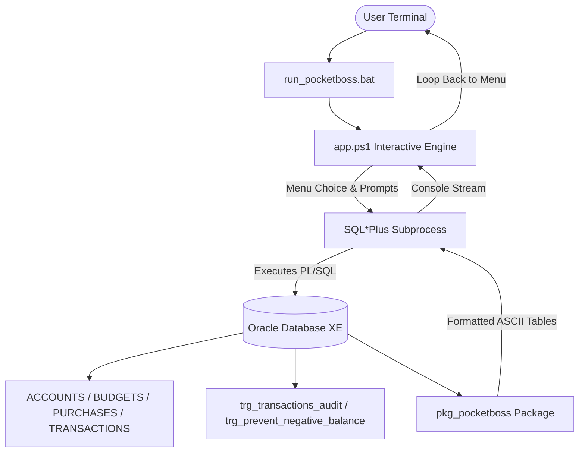
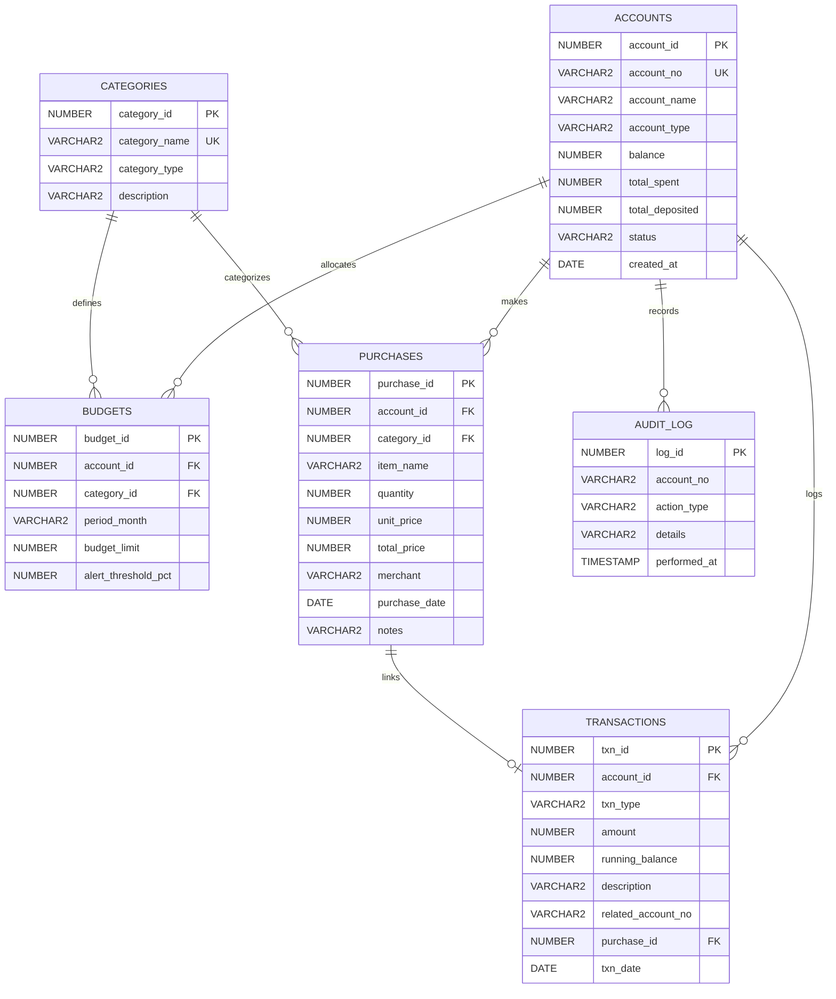

# PocketBoss: Technical System Manual & Architecture Reference

This document provides a comprehensive technical overview of **PocketBoss**, an enterprise-grade personal finance and expense management system powered by **Oracle PL/SQL** and wrapped in an interactive console interface.

---

## 📑 Table of Contents
1. [Project Overview & Workflow](#1-project-overview--workflow)
2. [Database Schema & Data Types](#2-database-schema--data-types)
3. [Default Users & Initial Seed Data](#3-default-users--initial-seed-data)
4. [Interactive Console Architecture](#4-interactive-console-architecture)
5. [Complete Stored Procedures & Functions Reference](#5-complete-stored-procedures--functions-reference)
6. [Business Logic & Guardrails](#6-business-logic--guardrails)

---

## 1. Project Overview & Workflow

PocketBoss is built on a **two-tier architecture**:
1. **Backend Database Layer (Oracle PL/SQL XE/19c/21c)**:
   - Houses the normalized relational schema, database constraints, sequences, and triggers.
   - Encapsulates business logic inside a unified PL/SQL package ([`pkg_pocketboss`](file:///c:/Users/Asus%20VivoBook/Desktop/pl_sql_lab_testing/mini_project/PocketBoss.sql#L203-L640)) alongside standalone wrapper procedures.
   - Handles transactions atomically using row-level locking (`SELECT ... FOR UPDATE`), transaction commits, and rollbacks on user-defined exceptions.
2. **Interactive Client Layer (`run_pocketboss.bat` + `app.ps1`)**:
   - Provides a continuous, menu-driven CLI loop running natively on Windows.
   - Prompts for user input with smart defaults, formats the input into dynamic PL/SQL anonymous blocks, pipes the blocks to Oracle SQL\*Plus, and streams formatted ASCII tables directly to the user's terminal.
   - Enables persistent state: transactions and balance modifications survive between executions without resetting the database.



---

## 2. Database Schema & Data Types

The system consists of six normalized relational tables, six independent sequences, and two integrity triggers.

### 2.1. Entity Relationship Diagram



---

### 2.2. Table Specifications

#### Table 1: `ACCOUNTS`
Stores bank and financial accounts.
| Column Name | Data Type | Constraints | Description |
| :--- | :--- | :--- | :--- |
| `account_id` | `NUMBER` | `PRIMARY KEY` | Internal surrogate identifier generated from `ACC_SEQ`. |
| `account_no` | `VARCHAR2(20)` | `NOT NULL, UNIQUE` | Formatted public account identifier (e.g., `'PB-1001'`). |
| `account_name` | `VARCHAR2(100)` | `NOT NULL` | Account holder's full legal name. |
| `account_type` | `VARCHAR2(30)` | `DEFAULT 'Checking'`, `CHECK IN ('Checking', 'Savings', 'Wallet', 'Investment')` | Account classification. |
| `balance` | `NUMBER(12,2)` | `DEFAULT 0.00, NOT NULL, CHECK (balance >= 0)` | Current liquid balance. Guaranteed non-negative. |
| `total_spent` | `NUMBER(12,2)` | `DEFAULT 0.00, NOT NULL` | Cumulative lifetime expenditure from this account. |
| `total_deposited` | `NUMBER(12,2)` | `DEFAULT 0.00, NOT NULL` | Cumulative lifetime deposits into this account. |
| `status` | `VARCHAR2(20)` | `DEFAULT 'ACTIVE'`, `CHECK IN ('ACTIVE', 'FROZEN', 'CLOSED')` | Account operational status. |
| `created_at` | `DATE` | `DEFAULT SYSDATE, NOT NULL` | Account establishment timestamp. |

---

#### Table 2: `CATEGORIES`
Defines financial budget categories.
| Column Name | Data Type | Constraints | Description |
| :--- | :--- | :--- | :--- |
| `category_id` | `NUMBER` | `PRIMARY KEY` | Category identifier generated from `CAT_SEQ`. |
| `category_name` | `VARCHAR2(50)` | `NOT NULL, UNIQUE` | Unique category name (e.g., `'Tech & Electronics'`). |
| `category_type` | `VARCHAR2(20)` | `DEFAULT 'EXPENSE'`, `CHECK IN ('EXPENSE', 'INCOME', 'TRANSFER')` | Flow category type. |
| `description` | `VARCHAR2(200)` | Nullable | Detailed scope of items in this category. |

---

#### Table 3: `BUDGETS`
Tracks spending caps and warning thresholds per account and month.
| Column Name | Data Type | Constraints | Description |
| :--- | :--- | :--- | :--- |
| `budget_id` | `NUMBER` | `PRIMARY KEY` | Identifier generated from `BUDGET_SEQ`. |
| `account_id` | `NUMBER` | `NOT NULL, FK -> ACCOUNTS(account_id) ON DELETE CASCADE` | Associated account. |
| `category_id` | `NUMBER` | `NOT NULL, FK -> CATEGORIES(category_id) ON DELETE CASCADE` | Associated category. |
| `period_month` | `VARCHAR2(7)` | `NOT NULL` | Billing month in `'YYYY-MM'` format (e.g., `'2026-10'`). |
| `budget_limit` | `NUMBER(12,2)` | `NOT NULL, CHECK (budget_limit > 0)` | Maximum allocated spending limit for the month. |
| `alert_threshold_pct` | `NUMBER(3)` | `DEFAULT 80, CHECK (alert_threshold_pct BETWEEN 1 AND 100)` | Warning percentage (e.g., alert at 80% utilization). |
| *Composite Key* | `UNIQUE` | `(account_id, category_id, period_month)` | Ensures only one budget per category per month. |

---

#### Table 4: `PURCHASES`
Stores granular, receipt-level purchased items.
| Column Name | Data Type | Constraints | Description |
| :--- | :--- | :--- | :--- |
| `purchase_id` | `NUMBER` | `PRIMARY KEY` | Purchase identifier generated from `PURCHASE_SEQ`. |
| `account_id` | `NUMBER` | `NOT NULL, FK -> ACCOUNTS(account_id) ON DELETE CASCADE` | Paying account. |
| `category_id` | `NUMBER` | `NOT NULL, FK -> CATEGORIES(category_id)` | Classification category. |
| `item_name` | `VARCHAR2(100)` | `NOT NULL` | Description of item bought. |
| `quantity` | `NUMBER(6)` | `DEFAULT 1, CHECK (quantity > 0)` | Quantity purchased. |
| `unit_price` | `NUMBER(12,2)` | `NOT NULL, CHECK (unit_price >= 0)` | Price per unit. |
| `total_price` | `NUMBER(12,2)` | `NOT NULL` | Computed total (`quantity * unit_price`). |
| `merchant` | `VARCHAR2(100)` | `DEFAULT 'General Store'` | Vendor / store name. |
| `purchase_date` | `DATE` | `DEFAULT SYSDATE, NOT NULL` | Exact transaction date. |
| `notes` | `VARCHAR2(250)` | Nullable | Optional memo or purchase context. |

---

#### Table 5: `TRANSACTIONS`
The double-entry general ledger tracking all monetary movements.
| Column Name | Data Type | Constraints | Description |
| :--- | :--- | :--- | :--- |
| `txn_id` | `NUMBER` | `PRIMARY KEY` | Transaction identifier generated from `TXN_SEQ`. |
| `account_id` | `NUMBER` | `NOT NULL, FK -> ACCOUNTS(account_id) ON DELETE CASCADE` | Source/destination account. |
| `txn_type` | `VARCHAR2(30)` | `NOT NULL, CHECK IN ('DEPOSIT', 'PURCHASE', 'TRANSFER_OUT', 'TRANSFER_IN', 'INTEREST')` | Nature of transaction. |
| `amount` | `NUMBER(12,2)` | `NOT NULL, CHECK (amount > 0)` | Transaction value. |
| `running_balance` | `NUMBER(12,2)` | `NOT NULL` | Account balance immediately after this transaction. |
| `description` | `VARCHAR2(250)` | Nullable | Human-readable transaction memo. |
| `related_account_no` | `VARCHAR2(20)` | Nullable | Counterparty account number (for transfers). |
| `purchase_id` | `NUMBER` | `FK -> PURCHASES(purchase_id) ON DELETE SET NULL` | Links directly to purchase receipt if applicable. |
| `txn_date` | `DATE` | `DEFAULT SYSDATE, NOT NULL` | Timestamp of ledger posting. |

---

#### Table 6: `AUDIT_LOG`
Automated system event log populated via database trigger.
| Column Name | Data Type | Constraints | Description |
| :--- | :--- | :--- | :--- |
| `log_id` | `NUMBER` | `PRIMARY KEY` | Event ID from `AUDIT_SEQ`. |
| `account_no` | `VARCHAR2(20)` | Nullable | Related account number. |
| `action_type` | `VARCHAR2(50)` | `NOT NULL` | Event tag (e.g., `'TRANSFER_OUT'`). |
| `details` | `VARCHAR2(400)` | Nullable | Complete audit description with pre/post balances. |
| `performed_at` | `TIMESTAMP` | `DEFAULT SYSTIMESTAMP, NOT NULL` | High-precision event timestamp. |

---

## 3. Default Users & Initial Seed Data

When [`PocketBoss.sql`](file:///c:/Users/Asus%20VivoBook/Desktop/pl_sql_lab_testing/mini_project/PocketBoss.sql) is initialized (Option `[1]`), the database seeds the following default accounts and categories:

### 3.1. Default Accounts
| Account Number | Account Holder | Account Type | Initial Deposit | Current Balance* | Initial Status | Primary Purpose in Demos |
| :--- | :--- | :--- | :--- | :--- | :--- | :--- |
| **`PB-1001`** | **Jeremy Davis** | `Checking` | $35,000.00 | ~$33,638.50 | `ACTIVE` | Primary operating account used for daily purchases, deposits, budgets, and transfer origin. |
| **`PB-1002`** | **Alice Vance** | `Savings` | $12,500.00 | ~$15,765.42 | `ACTIVE` | High-yield savings account used as peer-to-peer transfer recipient and compound interest simulation target. |
| **`PB-1003`** | **Bob Martinez** | `Checking` | $2,000.00 | $2,000.00 | `ACTIVE` | Low-balance account used to demonstrate **exception handling** (e.g., overdraft rejection when attempting a $99,999 transfer). |

*\* Note: Balances reflect state after the initial demo test run completes.*

---

### 3.2. Pre-Configured Expense & Income Categories
The database automatically seeds 8 standard categories:
1. `Groceries`: Supermarket, produce, ingredients.
2. `Dining & Cafes`: Restaurants, coffee shops, takeout.
3. `Tech & Electronics`: Hardware, gadgets, accessories, tools.
4. `Utilities & Bills`: Electricity, fiber broadband, mobile, water.
5. `Transportation`: Fuel, ride shares, train passes, vehicle maintenance.
6. `Entertainment`: Movies, streaming services, concerts, gaming.
7. `Salary & Income`: Primary employment salary, freelance contracts.
8. `Miscellaneous`: General unclassified expenses.

---

## 4. Interactive Console Architecture

### 4.1. Why It Stays Running (The Continuous Execution Loop)
In standard SQL\*Plus scripts, execution halts and returns to the command prompt after a batch finishes. PocketBoss overcomes this through [`app.ps1`](file:///c:/Users/Asus%20VivoBook/Desktop/pl_sql_lab_testing/mini_project/app.ps1) and [`run_pocketboss.bat`](file:///c:/Users/Asus%20VivoBook/Desktop/pl_sql_lab_testing/mini_project/run_pocketboss.bat):

1. **Launcher ([`run_pocketboss.bat`](file:///c:/Users/Asus%20VivoBook/Desktop/pl_sql_lab_testing/mini_project/run_pocketboss.bat))**:
   - Executes `powershell -NoProfile -ExecutionPolicy Bypass -File "%~dp0app.ps1"`.
   - Prevents the terminal from terminating immediately upon script completion.
2. **Infinite Navigation Loop (`while ($true)`)**:
   - `app.ps1` runs inside a continuous `while ($true)` loop.
   - Clears the screen and re-renders the ASCII dashboard menu after each operation.
   - Only exits when the user explicitly selects Option **`0`**.
3. **Subprocess Isolation via Stdin Pipe**:
   - Rather than keeping an open interactive SQL buffer (which risks syntax mistakes or buffer line edits), each menu operation dynamically constructs an anonymous PL/SQL block:
     ```powershell
     $script = @"
     SET DEFINE OFF;
     SET SERVEROUTPUT ON SIZE UNLIMITED;
     SET LINESIZE 160;
     $plsqlBlock
     EXIT;
     "@
     $output = $script | sqlplus -s bankuser/bankuser@//localhost:1521/XEPDB1
     ```
   - This block is piped directly into SQL\*Plus in silent mode (`-s`).
   - SQL\*Plus executes the PL/SQL engine, commits changes to disk, outputs the formatted text, and closes cleanly.
   - **Benefit**: Database changes (deposits, purchases, transfers) **persist immediately**, and the user is returned to the menu ready for the next command.

---

## 5. Complete Stored Procedures & Functions Reference

All business logic is defined in package [`pkg_pocketboss`](file:///c:/Users/Asus%20VivoBook/Desktop/pl_sql_lab_testing/mini_project/PocketBoss.sql#L203) with matching standalone procedures for direct SQL Developer execution.

---

### 5.1. `create_account`
*Creates a new financial account and posts an opening deposit ledger entry.*
- **Procedure Signature**:
  ```sql
  PROCEDURE create_account(
    p_account_name    IN  VARCHAR2,
    p_initial_deposit IN  NUMBER,
    p_account_type    IN  VARCHAR2 DEFAULT 'Checking',
    o_account_no      OUT VARCHAR2
  );
  ```
- **Input Parameters**:
  - `p_account_name` (`VARCHAR2`): Full name of the account holder.
  - `p_initial_deposit` (`NUMBER`): Opening deposit amount ($\ge 0$).
  - `p_account_type` (`VARCHAR2`): `'Checking'`, `'Savings'`, `'Wallet'`, or `'Investment'`. Default `'Checking'`.
- **Output Parameters**:
  - `o_account_no` (`VARCHAR2`): Generated account number (e.g., `'PB-1004'`).
- **Console Output**:
  ```text
  >>> Account successfully opened: PB-1004 (Sarah Connor) with initial balance $10,000.00
  ```
- **Exceptions Handled**: `e_invalid_amount` if deposit $< 0$; ORA-20007 if holder name is blank.

---

### 5.2. `deposit_funds`
*Credits money to an account, updates balance and total deposits, and records a ledger transaction.*
- **Procedure Signature**:
  ```sql
  PROCEDURE deposit_funds(
    p_account_no  IN VARCHAR2,
    p_amount      IN NUMBER,
    p_description IN VARCHAR2 DEFAULT 'Cash/Bank Deposit'
  );
  ```
- **Input Parameters**:
  - `p_account_no` (`VARCHAR2`): Target account number (e.g., `'PB-1001'`).
  - `p_amount` (`NUMBER`): Amount to credit ($> 0$).
  - `p_description` (`VARCHAR2`): Transaction description memo.
- **Console Output**:
  ```text
  >>> Deposit of $5,000.00 to [PB-1001] successful. New Balance: $40,000.00
  ```
- **Exceptions Handled**: `e_invalid_amount` ($amt \le 0$), `e_account_not_found`, `e_account_inactive`.

---

### 5.3. `record_purchase`
*Records an itemized purchase, verifies available funds, deducts balance, and checks real-time category budget status.*
- **Procedure Signature**:
  ```sql
  PROCEDURE record_purchase(
    p_account_no    IN VARCHAR2,
    p_item_name     IN VARCHAR2,
    p_category_name IN VARCHAR2,
    p_quantity      IN NUMBER,
    p_unit_price    IN NUMBER,
    p_merchant      IN VARCHAR2 DEFAULT 'Merchant',
    p_notes         IN VARCHAR2 DEFAULT NULL
  );
  ```
- **Input Parameters**:
  - `p_account_no` (`VARCHAR2`): Account used to pay.
  - `p_item_name` (`VARCHAR2`): Name/model of item bought.
  - `p_category_name` (`VARCHAR2`): One of the seeded categories.
  - `p_quantity` (`NUMBER`): Quantity bought ($\ge 1$).
  - `p_unit_price` (`NUMBER`): Price per unit ($\ge 0$).
  - `p_merchant` (`VARCHAR2`): Store/merchant name.
  - `p_notes` (`VARCHAR2`): Optional memo.
- **Console Output (3 possible budget outcomes)**:
  1. **Within Budget**:
     ```text
     >>> PURCHASE RECORDED: [Organic Milk] x1 @ $145.50 = $145.50
         Merchant: WholeFoods | Account: PB-1001 | Remaining Bal: $39,854.50
         [Budget Status: OK] $145.50 spent of $800.00 (18%).
     ```
  2. **Budget Threshold Reached Warning**:
     ```text
     >>> PURCHASE RECORDED: [UltraWide 34in Monitor] x1 @ $1,950.00 = $1,950.00
         Merchant: Amazon | Account: PB-1001 | Remaining Bal: $37,868.50
         [BUDGET WARNING - THRESHOLD REACHED!] Category "Tech & Electronics" is at 78% of monthly budget limit ($1,950.00 / $2,500.00).
     ```
  3. **Budget Exceeded Alert**:
     ```text
     >>> PURCHASE RECORDED: [Mechanical Keyboard] x1 @ $750.00 = $750.00
         Merchant: Keychron | Account: PB-1001 | Remaining Bal: $37,118.50
         [BUDGET ALERT - EXCEEDED!] Category "Tech & Electronics" spending is $2,700.00 / $2,500.00 (108%). Over budget by $200.00!
     ```
- **Exceptions Handled**: `e_insufficient_funds` (purchase aborted if balance $< total$), `e_invalid_amount`, `e_category_not_found`, `e_account_not_found`.

---

### 5.4. `transfer_funds`
*Transfers money between two accounts with strict row-locking atomicity and dual ledger entries.*
- **Procedure Signature**:
  ```sql
  PROCEDURE transfer_funds(
    p_from_acc_no IN VARCHAR2,
    p_to_acc_no   IN VARCHAR2,
    p_amount      IN NUMBER,
    p_description IN VARCHAR2 DEFAULT 'Peer-to-Peer Transfer'
  );
  ```
- **Input Parameters**:
  - `p_from_acc_no` (`VARCHAR2`): Source account number.
  - `p_to_acc_no` (`VARCHAR2`): Destination account number.
  - `p_amount` (`NUMBER`): Transfer amount ($> 0$).
  - `p_description` (`VARCHAR2`): Transfer memo.
- **Console Output on Success**:
  ```text
  >>> Transfer SUCCESSFUL: $3,200.00 transferred from [PB-1001] to [PB-1002].
      Sender New Balance: $33,638.50 | Recipient New Balance: $15,700.00
  ```
- **Console Output on Failure (Exceptions Showcase)**:
  - Insufficient funds:
    ```text
    [TRANSFER FAILED] Insufficient funds in [PB-1003]. Current Balance: $2,000.00, Requested: $99,999.00
    ```
  - Self transfer:
    ```text
    [TRANSFER FAILED] Sender and recipient accounts cannot be the same (PB-1001).
    ```
  - Missing account:
    ```text
    [ERROR] Recipient account [PB-99999] does not exist.
    [TRANSFER FAILED] Transaction aborted: Account verification failed.
    ```

---

### 5.5. `set_budget`
*Sets or updates the monthly spending limit and warning threshold for an account and category.*
- **Procedure Signature**:
  ```sql
  PROCEDURE set_budget(
    p_account_no    IN VARCHAR2,
    p_category_name IN VARCHAR2,
    p_period_month  IN VARCHAR2, -- 'YYYY-MM'
    p_budget_limit  IN NUMBER,
    p_threshold_pct IN NUMBER DEFAULT 80
  );
  ```
- **Input Parameters**:
  - `p_account_no` (`VARCHAR2`): Target account.
  - `p_category_name` (`VARCHAR2`): Target category name.
  - `p_period_month` (`VARCHAR2`): Target month (e.g., `'2026-10'`).
  - `p_budget_limit` (`NUMBER`): Maximum spending limit ($> 0$).
  - `p_threshold_pct` (`NUMBER`): Alert threshold percentage (1–100, default 80).
- **Console Output**:
  ```text
  >>> New budget created for [PB-1001], Category: Tech & Electronics, Month: 2026-10 -> Limit: $2,500.00
  ```

---

### 5.6. `show_account_summary`
*Renders a formatted overview card with lifetime statistics and financial health tier.*
- **Procedure Signature**:
  ```sql
  PROCEDURE show_account_summary(p_account_no IN VARCHAR2);
  ```
- **Console Output (ASCII Card)**:
  ```text
  +------------------------------------------------------------------------------+
  |                       POCKETBOSS ACCOUNT DASHBOARD                           |
  +------------------------------------------------------------------------------+
  | Account Number     : PB-1001                                                 |
  | Account Holder     : Jeremy Davis                                            |
  | Account Type       : Checking                                                |
  | Account Status     : ACTIVE                                                  |
  | Created Date       : 22-OCT-2026 08:37                                       |
  +------------------------------------------------------------------------------+
  | Current Balance    : $33,638.50                                              |
  | Lifetime Deposited : $40,000.00                                              |
  | Lifetime Spent     : $3,161.50                                               |
  | Total Transactions : 9                                                       |
  | Financial Tier     : GOLD (Strong)                                           |
  +------------------------------------------------------------------------------+
  ```

---

### 5.7. `show_budget_report`
*Generates an executive ASCII table comparing budgeted limits vs. actual spending, variance, visual progress bars, and status labels.*
- **Procedure Signature**:
  ```sql
  PROCEDURE show_budget_report(
    p_account_no   IN VARCHAR2,
    p_period_month IN VARCHAR2
  );
  ```
- **Console Output (ASCII Table)**:
  ```text
  ===================================================================================================================
                                 POCKETBOSS MONTHLY BUDGET PERFORMANCE REPORT                                        
   Account: PB-1001 (Jeremy Davis)       Period: 2026-10       Generated: 22-OCT-2026 08:37
  ===================================================================================================================
  +----------------------+---------------+---------------+---------------+----------------------+-------------------+
  | Category Name        |  Budget Limit |  Actual Spent |   Variance    |  Budget Utilization  | Status            |
  +----------------------+---------------+---------------+---------------+----------------------+-------------------+
  | Dining & Cafes       |       $600.00 |       $196.00 |       $404.00 | [====        ]  33%  | SAFE (On Track)   |
  | Groceries            |       $800.00 |       $145.50 |       $654.50 | [==          ]  18%  | SAFE (On Track)   |
  | Tech & Electronics   |     $2,500.00 |     $2,700.00 |      $-200.00 | [============] 108%  | !! EXCEEDED !!    |
  | Utilities & Bills    |       $450.00 |       $120.00 |       $330.00 | [===         ]  27%  | SAFE (On Track)   |
  +----------------------+---------------+---------------+---------------+----------------------+-------------------+
  | TOTALS               |     $4,350.00 |     $3,161.50 |     $1,188.50 | [=========   ]  73%  | OVERALL HEALTHY   |
  +----------------------+---------------+---------------+---------------+----------------------+-------------------+
  ```

---

### 5.8. `show_purchases_report`
*Executes an explicit parameterized cursor (`c_purchases`) with `OPEN`, `FETCH`, `EXIT WHEN %NOTFOUND`, and `CLOSE` to generate an itemized purchase receipt ledger.*
- **Procedure Signature**:
  ```sql
  PROCEDURE show_purchases_report(
    p_account_no   IN VARCHAR2,
    p_period_month IN VARCHAR2 DEFAULT NULL
  );
  ```
- **Console Output (ASCII Table)**:
  ```text
  ===================================================================================================================
                                 POCKETBOSS ITEMIZED PURCHASES & EXPENSE LEDGER                                      
   Account: PB-1001 (Jeremy Davis)       Period: 2026-10       Generated: 22-OCT-2026 08:37
  ===================================================================================================================
  +------+----------------------+----------------------+-----+-------------+-------------+------------------+-------------+
  | ID   | Item Description     | Category             | Qty |  Unit Price | Total Price | Merchant         | Date        |
  +------+----------------------+----------------------+-----+-------------+-------------+------------------+-------------+
  |    6 | Weekend Sushi Dinner | Dining & Cafes       |   1 |     $160.00 |     $160.00 | Sakura Bistro    | 22-OCT-2026 |
  |    5 | Fiber Internet 1Gbps | Utilities & Bills    |   1 |     $120.00 |     $120.00 | Spectrum         | 22-OCT-2026 |
  |    4 | Mechanical Gaming Ke | Tech & Electronics   |   1 |     $750.00 |     $750.00 | Keychron         | 22-OCT-2026 |
  |    3 | UltraWide 34in Monit | Tech & Electronics   |   1 |   $1,950.00 |   $1,950.00 | Amazon           | 22-OCT-2026 |
  |    2 | Espresso & Croissant | Dining & Cafes       |   2 |      $18.00 |      $36.00 | Artisan Roasters | 22-OCT-2026 |
  |    1 | Organic Milk & Veget | Groceries            |   1 |     $145.50 |     $145.50 | WholeFoods       | 22-OCT-2026 |
  +------+----------------------+----------------------+-----+-------------+-------------+------------------+-------------+
  | TOTAL PURCHASES:    7 items                                                               GRAND TOTAL: $3,161.50 |
  +------------------------------------------------------------------------------------------------------------------+
  ```

---

### 5.9. `show_account_statement`
*Renders the complete double-entry general ledger statement showing every deposit, purchase, transfer, and running balance.*
- **Procedure Signature**:
  ```sql
  PROCEDURE show_account_statement(p_account_no IN VARCHAR2);
  ```
- **Console Output (ASCII Table)**:
  ```text
  ===================================================================================================================
                                POCKETBOSS OFFICIAL ACCOUNT STATEMENT & LEDGER                                       
   Account: PB-1001 (Jeremy Davis)       Closing Balance: $33,638.50       Statement Date: 22-OCT-2026
  ===================================================================================================================
  +-------+-------------+--------------+---------------+------------------------------------------+------------------+
  | Txn # | Date        | Type         |        Amount | Description                              | Running Balance  |
  +-------+-------------+--------------+---------------+------------------------------------------+------------------+
  |  5001 | 22-OCT-2026 | DEPOSIT      |    $35,000.00 | Initial Account Opening Deposit          |       $35,000.00 |
  |  5004 | 22-OCT-2026 | DEPOSIT      |     $5,000.00 | Bonus Direct Deposit                     |       $40,000.00 |
  |  5005 | 22-OCT-2026 | PURCHASE     |       $145.50 | Purchased Organic Milk & Vegetables (Gro |       $39,854.50 |
  |  5006 | 22-OCT-2026 | PURCHASE     |        $36.00 | Purchased Espresso & Croissant (Dining & |       $39,818.50 |
  |  5007 | 22-OCT-2026 | PURCHASE     |     $1,950.00 | Purchased UltraWide 34in Monitor (Tech & |       $37,868.50 |
  |  5008 | 22-OCT-2026 | PURCHASE     |       $750.00 | Purchased Mechanical Gaming Keyboard (Te |       $37,118.50 |
  |  5009 | 22-OCT-2026 | PURCHASE     |       $120.00 | Purchased Fiber Internet 1Gbps (Utilitie |       $36,998.50 |
  |  5010 | 22-OCT-2026 | PURCHASE     |       $160.00 | Purchased Weekend Sushi Dinner (Dining & |       $36,838.50 |
  |  5011 | 22-OCT-2026 | TRANSFER_OUT |     $3,200.00 | Project Consulting Reimbursement (To PB- |       $33,638.50 |
  +-------+-------------+--------------+---------------+------------------------------------------+------------------+
  | Total Entries:    9                                                                 CURRENT BALANCE: $33,638.50 |
  +------------------------------------------------------------------------------------------------------------------+
  ```

---

### 5.10. `simulate_savings_growth`
*Demonstrates a PL/SQL `WHILE` loop to simulate future compound interest and recurring deposit growth month-by-month.*
- **Procedure Signature**:
  ```sql
  PROCEDURE simulate_savings_growth(
    p_account_no      IN VARCHAR2,
    p_months          IN NUMBER,
    p_monthly_deposit IN NUMBER,
    p_annual_rate_pct IN NUMBER
  );
  ```
- **Console Output (ASCII Projection Table)**:
  ```text
  ===================================================================================================
                      POCKETBOSS SAVINGS COMPOUND GROWTH PROJECTION (WHILE LOOP DEMO)                 
   Base Balance: $15,700.00 | Monthly Add: $1,000.00 | Annual Rate: 6.5% | Duration: 6 Months
  ===================================================================================================
  +--------+-------------------+--------------------+--------------------+---------------------------+
  | Month  | Starting Balance  | Monthly Addition   | Interest Earned    | End of Month Balance      |
  +--------+-------------------+--------------------+--------------------+---------------------------+
  |      1 |        $15,700.00 |          $1,000.00 |             $90.46 |                $16,790.46 |
  |      2 |        $16,790.46 |          $1,000.00 |             $96.36 |                $17,886.82 |
  |      3 |        $17,886.82 |          $1,000.00 |            $102.30 |                $18,989.13 |
  |      4 |        $18,989.13 |          $1,000.00 |            $108.27 |                $20,097.40 |
  |      5 |        $20,097.40 |          $1,000.00 |            $114.28 |                $21,211.68 |
  |      6 |        $21,211.68 |          $1,000.00 |            $120.31 |                $22,331.99 |
  +--------+-------------------+--------------------+--------------------+---------------------------+
  | FINAL PROJECTED BALANCE: $22,331.99 | Total Interest Earned: $631.99 |
  +--------------------------------------------------------------------------------------------------+
  ```

---

### 5.11. `batch_apply_interest`
*Iterates across all active savings accounts using a cursor `FOR UPDATE` loop, calculates monthly interest, and updates accounts and ledger transactions.*
- **Procedure Signature**:
  ```sql
  PROCEDURE batch_apply_interest(p_annual_rate_pct IN NUMBER);
  ```
- **Console Output**:
  ```text
  >>> Starting Batch Monthly Interest Processing @ 5% p.a. ...
      * Credited $65.42 interest to [PB-1002] (Alice Vance). New Bal: $15,765.42
  >>> Batch Interest Completed. Total Accounts Credited: 1
  ```

---

### 5.12. Key Utility Functions
- **`fn_format_currency(p_amount NUMBER) RETURN VARCHAR2`**: Converts raw numbers into formatted currency strings (e.g., `12500` &rarr; `'$12,500.00'`).
- **`fn_progress_bar(p_current NUMBER, p_total NUMBER, p_bar_length NUMBER) RETURN VARCHAR2`**: Generates ASCII visual bars with percentage text using numeric `FOR` loops:
  - 33%: `[====          ]  33%`
  - 73%: `[=========     ]  73%`
  - 108%: `[============  ] 108%`
- **`fn_get_health_badge(p_balance NUMBER, p_total_spent NUMBER) RETURN VARCHAR2`**: Employs PL/SQL `CASE` logic to rate account stability:
  - $\ge \$50,000$: `PLATINUM (Excellent)`
  - $\ge \$20,000$: `GOLD (Strong)`
  - $\ge \$5,000$: `SILVER (Moderate)`
  - $> \$0$: `BRONZE (Watch Out)`
  - $\le \$0$: `CRITICAL (Overdrawn/Empty)`

---

## 6. Business Logic & Guardrails

1. **No Overdraft Guarantee**:
   - Stored procedures verify `balance >= total_cost` before performing deductions.
   - Database trigger `trg_prevent_negative_balance` provides a secondary defense layer by rejecting any update that causes `balance < 0` with error `ORA-20010`.
2. **Transfer Self-Transfer & Entity Validation**:
   - Transfers between the same account number are trapped and rejected via user-defined exception `e_same_account_transfer`.
   - Both sender and receiver accounts are verified to exist and have status `'ACTIVE'`.
3. **Transaction Safety (ACID)**:
   - Account balances are locked during updates with `SELECT ... FOR UPDATE`.
   - If any step of a multi-table operation fails (e.g. transfer credit succeeds but debit fails), a strict `ROLLBACK` reverts all changes to avoid orphaned transactions.
